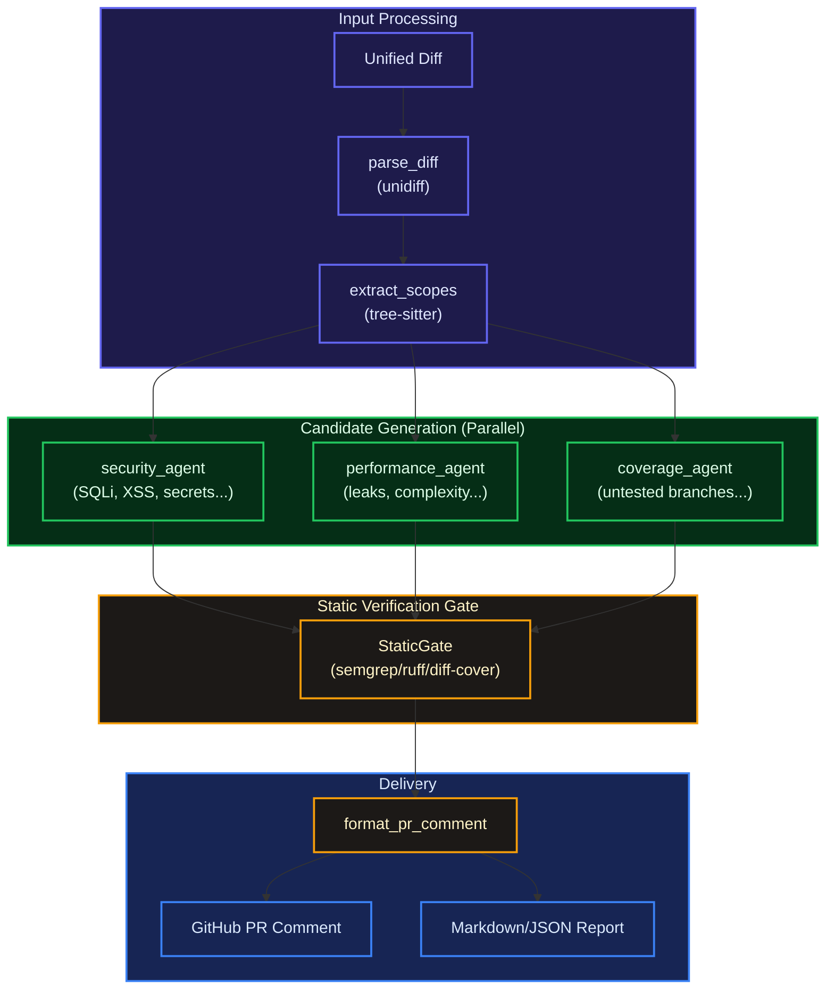

# Kosen — Agentic Code Reviewer

> Production-grade agentic code review system that eliminates false positives through deterministic static-tool grounding, preserves context with AST chunking, and evaluates performance against CVE advisory databases.

## The Problem

Traditional code review tools either:
**LLM-only**: High false positives, no verification, hallucinated fixes
**Static-only**: High noise, no semantic understanding, misses logic bugs

Kosen bridges both: LLM agents *propose* candidates, but every finding must pass a **static tool verification gate** (semgrep, ruff, diff-cover) before being reported. Only `VERIFIED` findings reach developers.

## What it does

Submit a diff (local file, git diff, or GitHub PR). Kosen parses changed lines, maps them to enclosing functions/classes via Tree-sitter, runs parallel LLM agents (Security, Performance, Coverage) to propose findings, then verifies every candidate against semgrep/ruff/diff-cover. Only `VERIFIED` findings reach developers — as PR comments, markdown reports, or GitHub Action.

## Architecture



## Tech Stack

| Layer | Technology |
|-------|------------|
| LLM | NVIDIA NIM (Nemotron-3-Nano-Omni-30b-a3b-reasoning) via OpenAI-compatible API |
| Orchestration | LangGraph (StateGraph, parallel agents) |
| Static Analysis | semgrep (security-audit, OWASP), ruff (B, SIM, PERF), diff-cover |
| Parsing | unidiff (diff), tree-sitter (Python AST) |
| GitHub | PyGithub + tenacity retries |
| Packaging | pyproject.toml (src-layout, ruff, mypy, pytest) |

## Features

| Category | Checks |
|----------|--------|
| **Security** | SQLi, XSS, command injection, path traversal, hardcoded secrets, auth bypass, weak crypto |
| **Performance** | Resource leaks (files/DB), N+1 queries, O(n²) loops, missing exception handling, bugbear rules |
| **Syntax** | Type errors, undefined vars, unreachable code, SIM simplifications |
| **Coverage** | Untested branches, missing edge cases, untested error paths |

## Two Interfaces

| Interface | Command | For |
|-----------|---------|-----|
| **CLI** | `kosen review diff.patch -s .` | Developers, CI scripts |
| **GitHub Action** | `.github/actions/kosen-review` | Teams, automatic PR reviews |

## Project Structure

```
src/
├── config.py              # Settings & tool commands
├── schemas.py             # Pydantic models
├── cli.py                 # CLI (review, github)
├── github.py              # PyGithub PR integration
├── parser/
│   ├── diff_parser.py     # Unidiff → changed line ranges
│   └── ast_scope.py       # Tree-sitter → function/class scopes
├── agents/
│   ├── security.py        # SQLi, XSS, secrets, etc.
│   ├── performance.py     # Leaks, complexity, bugbear
│   └── coverage.py        # Untested branches
├── verification/
│   ├── static_gate.py     # 2-tier verification
│   ├── semgrep_verifier.py
│   ├── ruff_verifier.py
│   └── diff_cover_verifier.py
├── graph/
│   ├── workflow.py        # LangGraph StateGraph
│   └── explainer.py       # PR comment formatting
└── benchmark/
    ├── fetch_dataset.py
    └── evaluate.py
```

## Author

**Vinesh**

Built with ❤️